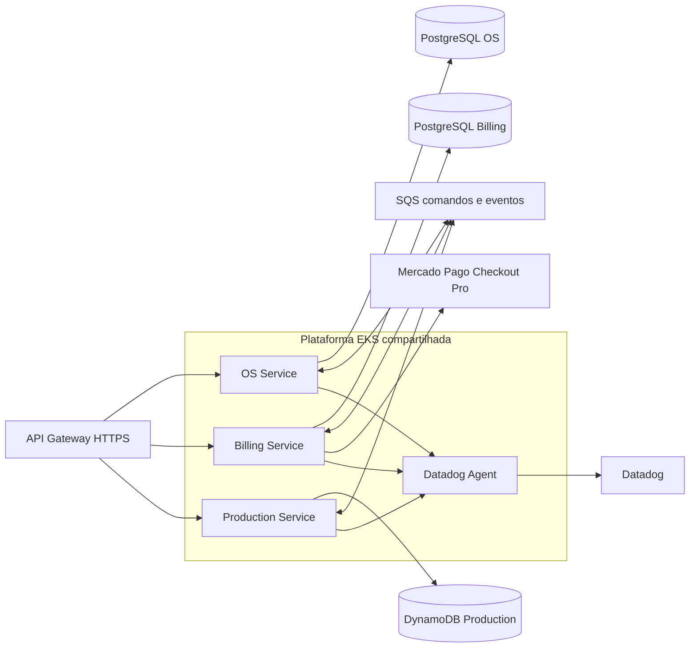

# oficina-infra-kubernetes

Plataforma EKS e observabilidade compartilhada da Oficina na Fase 4. OS, Billing e Producao possuem seus proprios repositorios, releases Helm, filas, bancos e states. Este repositorio provisiona o cluster e nao compartilha os bancos entre os servicos.

## Recursos

- VPC default do AWS Academy, usando subnets fora da AZ nao suportada `us-east-1e`.
- EKS com versao explicita, roles pre-existentes separadas para cluster e nodes e acesso administrativo via role `voclabs` da conta atual.
- Managed node group AL2023, padrao 2 nodes `t3.medium` e limite 4.
- Add-ons `vpc-cni`, `kube-proxy`, `coredns` e metrics-server via Helm.
- ECR historico da plataforma; cada microsservico Fase 4 possui tambem seu proprio ECR no seu repositorio.
- Datadog Agent, dashboard, monitores por servico/Saga, filas e Synthetic, habilitados apenas com configuracao e chaves reais.

## Estrutura e checks

`aws/` contem EKS/rede/ECR/add-ons/Helm; `observability/` contem dashboard/monitores/Synthetic; `scripts/` contem os controles de CI e plano aprovado. Terraform 1.16, providers fixados nos lockfiles, TFLint e GitHub Actions sao usados na validacao.

O CI exige fmt, init sem backend, validate e TFLint para ambos os stacks, nos checks **Validate aws** e **Validate observability**. O job **Plan controls** testa offline a verificacao de origem/CI, aprovacao de execucao e fingerprint, inclusive com Terraform simulado. O check obrigatorio **Plan aws** continua executando **um plano AWS real** nos PRs do proprio repositorio, apos validacoes offline, sem apply ou bootstrap do backend. Nomes e semantica dos checks obrigatorios da `main` sao preservados.

## Deploy por GitHub Actions

Todos os deploys reais usam **Terraform deploy**, com `operation=plan` ou `apply`, SHA completo e branch de origem. Nao ha apply automatico por push na `main`. Caso o formulario manual nao esteja disponivel porque o workflow esta apenas na feature, use tags `phase4/platform-plan-*` e `phase4/platform-apply-*` no HEAD da Repository Variable `DEPLOY_SOURCE_REF` (padrao `feature/phase4-distributed`). O push de uma tag operacional inicia a execucao correspondente.

O workflow exige CI completo do mesmo repositorio/branch/SHA antes de acessar a AWS. O plano explicito pode preparar o bucket protegido `oficina-tc3-tfstate-<conta>`. Apos revisar seu artefato de texto, configure `PLATFORM_APPROVED_PLAN_RUN_ID` no Environment `homolog`; apply verifica a execucao aprovada e regenera/compara o texto e o fingerprint canonico antes de aplicar o plano salvo. Delete/replace de recursos e divergencias bloqueiam a aplicacao. Binarios de plano, JSON bruto e state nunca sao artifacts.

Configure em `homolog` as credenciais temporarias AWS e as Variables explicitas `EXPECTED_AWS_ACCOUNT_ID`, `KUBERNETES_VERSION`, `CLUSTER_ROLE_ARN` e `NODE_ROLE_ARN`. `PRINCIPAL_ARN` e opcional; vazio deriva `voclabs` na conta atual. O codigo suporta fallback das roles para `lab_role_arn`; o workflow solicita overrides explicitos para o ambiente Academy com roles distintas. O minor EKS deve estar em `STANDARD_SUPPORT`, verificado pelo workflow; nao existe default legado automatico.

Datadog fica desabilitado por padrao. Habilitar exige `DATADOG_ENABLED=true`, secret real e URL HTTPS publica da aplicacao. Um plano que removeria um Agent existente continua bloqueado. Secrets sensitive podem estar no state, que requer criptografia e controle de acesso, mesmo quando ocultos na exibicao do Terraform.

- [Configuracao Fase 4, variaveis e contrato de telemetria](docs/configuracao-fase4.md)
- [Procedimento de plano, revisao e aplicacao](docs/platform-actions.md)

## Verificacao local

`node --test scripts/*.test.mjs` executa testes sem AWS real. Para cada stack, execute `terraform fmt -check -recursive`, `terraform init -backend=false -input=false -lockfile=readonly`, `terraform validate` e TFLint. Os comandos completos estao no procedimento acima. Validacao local nao comprova provisionamento ou observabilidade ativa; os links dos runs, outputs e evidencias reais devem ser adicionados apos a execucao autorizada dos Actions.
